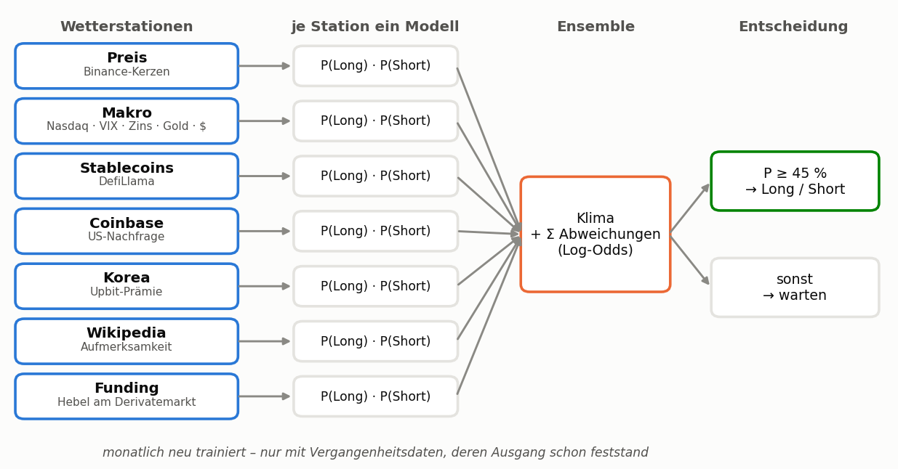
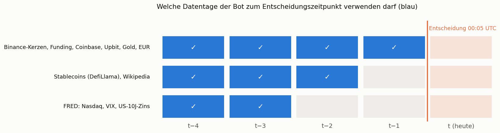
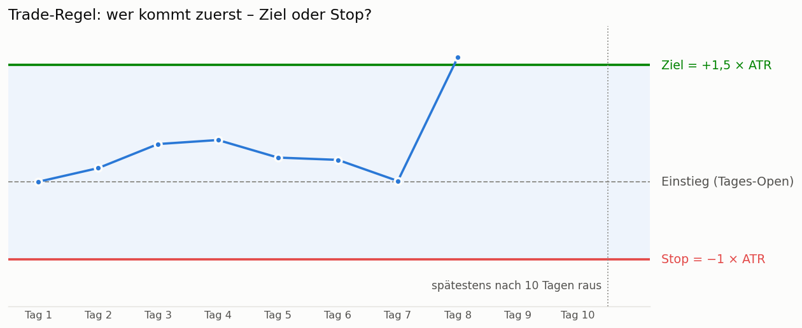
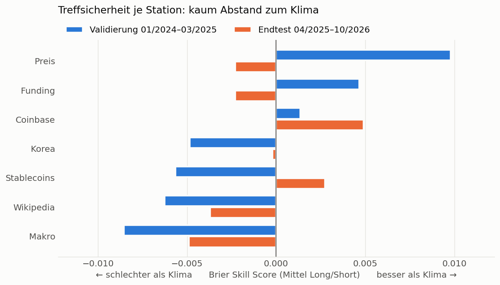
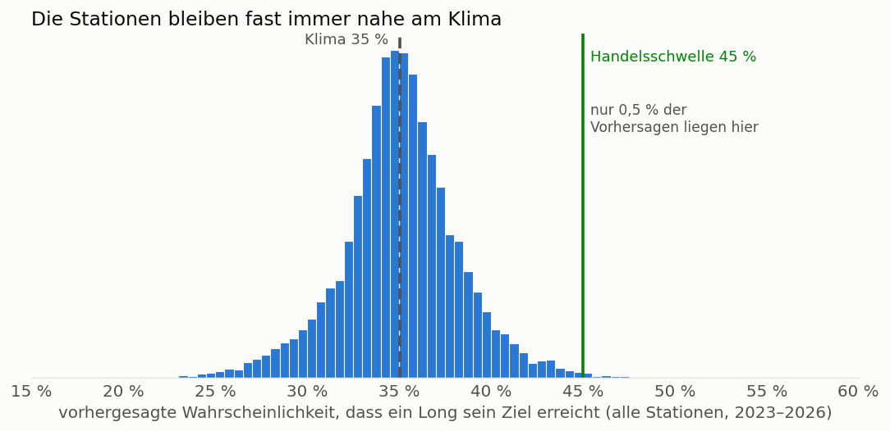
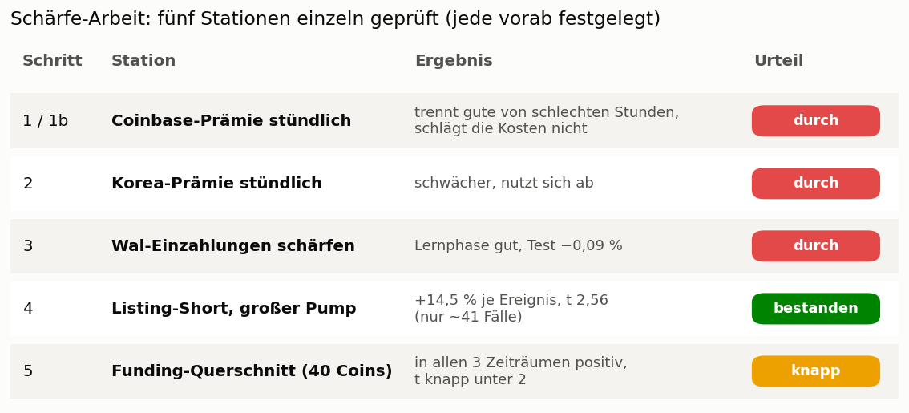
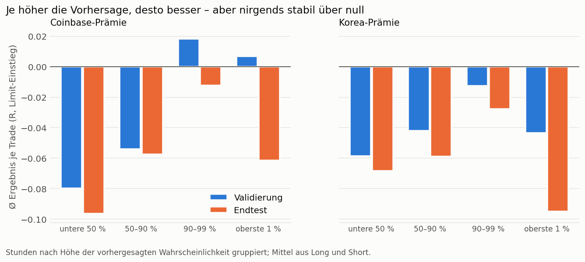
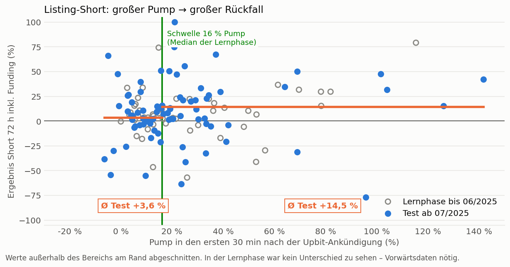
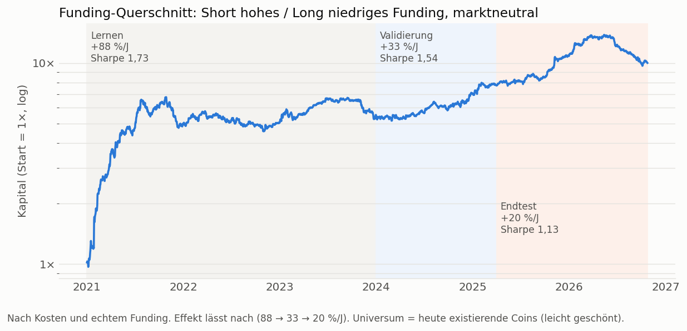

<p align="center">
  
</p>

> 🚧 **Baustelle:** Dieser Bot ist aktuell **nicht live** und wird weiterentwickelt. Er läuft nur im Papiermodus (kein Echtgeld).

# wbot v2 — „Weltwetter“

Ein Trading-Bot, der wie ein Wetterdienst arbeitet: Statt tausend Indikatoren auf dem eigenen Kurs sammelt er
jeden Tag Messwerte von **Wetterstationen aus der ganzen Welt** — US-Börse, Zinsen, Gold, Dollar, Stablecoin-Menge,
US- und Korea-Nachfrage, Wikipedia-Aufmerksamkeit, Hebel am Derivatemarkt — und macht daraus eine
**Wahrscheinlichkeitsvorhersage**: „Long-Ziel wird mit 41 % erreicht, Short-Ziel mit 30 %“.

> **Stand 26.10.2026: Der vorab festgelegte Test ist NICHT bestanden.** Der Bot läuft deshalb nur im
> **Papiermodus** und misst jeden Tag vorwärts, ob eine Station doch Vorhersagekraft hat. Echtgeld ist gesperrt.
> Details: [forschung/PRAEREGISTRIERUNG.md](forschung/PRAEREGISTRIERUNG.md).
>
> **Schärfe-Arbeit:** Fünf weitere Stationen wurden einzeln geprüft. Bestanden hat der **Listing-Short bei großem
> Pump**, knapp verfehlt der **Funding-Querschnitt** – siehe [Schärfe-Arbeit](#schärfe-arbeit-wie-werden-die-vorhersagen-scharf-genug).

(Der alte wbot v1 „QGRS“ — Monte-Carlo-Range mit Physik-Indikatoren — ist ersetzt. Er war schlechter als ein einfacher
14-Tage-Durchschnitt und hatte einen Fehler, durch den BTC/ETH/DOGE nie handelten. Er steht in der Git-Historie.)

---

## So funktioniert es



Wie beim Wetterdienst gilt: **Jede Station misst etwas anderes.** Jede bekommt ihr eigenes kleines Modell, das
sagt, wie sich die Chance auf einen erfolgreichen Long- oder Short-Trade gegenüber dem Durchschnitt („Klima“)
verschiebt. Das Ensemble zählt diese Verschiebungen zusammen. Erst wenn die Chance deutlich über dem Klima liegt
(≥ 45 %), wird gehandelt.

| Station | Quelle | Idee |
|---|---|---|
| Preis | Binance-Futures-Tageskerzen | aktueller Zustand (Renditen, Lage im Band, Vola) |
| Makro | FRED (Nasdaq, VIX, US-10J-Zins), Binance PAXG (Gold), EUR/USDT (Dollar) | Risikoappetit der Welt |
| Stablecoins | DefiLlama Gesamtmenge | frisches Kapital |
| Coinbase | Coinbase vs. Binance | US-Nachfrage |
| Korea | Upbit vs. Binance | asiatische Privatanleger |
| Wikipedia | Seitenaufrufe je Coin + Bitcoin | Aufmerksamkeit der Privatanleger |
| Funding | Binance-Funding je Coin | Hebel-Überhang |

Jede Quelle wird nur mit dem Stand verwendet, der um 00:05 UTC wirklich schon veröffentlicht ist (FRED +2 Tage,
Wikipedia und Stablecoins +1 Tag). Ein Test prüft, dass keine Zukunftsdaten hineinrutschen.



**Trade:** Einstieg zum Tages-Open, Ziel 1,5 × ATR, Stop 1 × ATR, spätestens nach 10 Tagen raus. Kosten 0,22 % +
echtes Funding. Eine Position je Coin. Coins: BTC, ETH, SOL, XRP, DOGE, BNB.



Die Vorhersage beantwortet genau diese Frage: *Wie wahrscheinlich ist es, dass die grüne Linie vor der roten
erreicht wird?* Im Durchschnitt aller Tage („Klima“) sind das für Long 35 %, für Short 31 %.

**Prüfung wie beim Wetterdienst:** Der *Brier Skill Score* (BSS) vergleicht die Vorhersage mit dem Klima
(= durchschnittliche Trefferquote). BSS > 0 heißt: besser als einfach immer den Durchschnitt anzunehmen.

## Ergebnis des Tests

Die Regeln wurden **vor** dem Testlauf festgeschrieben ([PRAEREGISTRIERUNG.md](forschung/PRAEREGISTRIERUNG.md)):
Stationen werden in der Validierung (01/2024–03/2025) ausgewählt, das Ensemble wird einmalig im unberührten
Endtest (04/2025–10/2026) geprüft. Bestanden hätte es mit BSS > 0, Profitfaktor ≥ 1,2, Ø ≥ +0,1 R pro Trade,
≥ 4 von 6 Coins im Plus und ≥ 100 Trades pro Jahr.



Die Balken sind winzig: Ein BSS von 0,005 heißt, die Station ist 0,5 % besser als der Durchschnitt. Die meisten
Stationen sind in einem Zeitraum leicht besser und im anderen leicht schlechter – das ist Rauschen.
**Nur Coinbase liegt in beiden Zeiträumen über null.**



Deshalb gibt es kaum Trades: Die Vorhersagen bleiben fast immer zwischen 30 und 40 %, die Handelsschwelle von 45 %
wird nur sehr selten erreicht.

| | Ergebnis Endtest | Ziel |
|---|---|---|
| aufgenommene Stationen | nur Preis | – |
| BSS | −0,002 | > 0 |
| Trades pro Jahr | 29 | ≥ 100 |
| Ø pro Trade | −0,016 R | ≥ +0,1 R |
| Profitfaktor | 0,97 | ≥ 1,2 |
| Coins im Plus | 2 / 6 | ≥ 4 |

**→ Nicht bestanden.** Der Bot läuft im Papiermodus und misst alle Stationen ab jetzt vorwärts. Eine
Vorwärtsmessung ist der einzige ehrliche Test, der noch übrig ist, weil alle historischen Daten jetzt bekannt sind.

Nachträglicher Plausibilitätscheck (kein Beweis, Daten bekannt): Die reine Coinbase-Regel „Prämie > 0 → am
nächsten Tag Long“ ist auf Tagesbasis im Wesentlichen nur ein Teil des Marktes (Sharpe in 4 von 6 Zeiträumen nicht
besser als einfach halten). Sie wurde deshalb nicht eingebaut.

## Schärfe-Arbeit: Wie werden die Vorhersagen scharf genug?

Das Histogramm oben zeigt das Kernproblem: Die Vorhersagen kleben am Klima. Profitabel wird so ein Bot nur, wenn
die Vorhersage an manchen Tagen **deutlich** vom Durchschnitt abweicht – und dann recht behält. Deshalb wurde jede
Idee einzeln, Stück für Stück und jeweils **vorab festgelegt** geprüft
(Regeln und Skripte: [forschung/schaerfe/](forschung/schaerfe/)).



### Schritt 1–2: Prämien stündlich statt täglich

Die Information der Coinbase- und Korea-Prämie lebt nur Stunden. Auf Stundenbasis gemessen werden die Vorhersagen
tatsächlich schärfer und stimmen auch (wo 20 % vorhergesagt werden, kommen ~20 % heraus). Die besten Stunden sind
deutlich besser als die schlechtesten – aber selbst mit Limit-Einstieg (Maker-Gebühr, nur gefüllt, wenn der Kurs das
Limit wirklich durchschreitet) bleibt das Ergebnis im Endtest unter null.



### Schritt 3: Wal-Einzahlungen schärfen

Der Wal-Effekt aus dem kbot (Short nach großen Einzahlungen auf Binance, +0,2 % brutto) sollte mit fünf
Eigenschaften der Einzahlung (Größe, Kursanstieg davor, Absender, Häufung, BTC-Lage) geschärft werden. In der
Lernphase brachten die besten 30 % +0,17 % netto, im Test −0,09 %. Nicht schärfbar.

### Schritt 4: Listing-Short nach Pump-Größe – bestanden

Nach einer Upbit-Listing-Ankündigung schießt der Coin hoch und fällt danach meist zurück. Neu: nur shorten, wenn
der Pump in den ersten 30 min groß war (≥ 16 %, Median der Lernphase).



| Test ab 07/2025 | großer Pump | kleiner Pump |
|---|---|---|
| Ereignisse | 41 | 38 |
| Ø Ergebnis inkl. Funding | **+14,5 %** | +3,6 % |
| t-Wert | **2,56** | 0,86 |
| Gewinner | 76 % | 61 % |

**Einschränkung:** In der Lernphase war der Unterschied nicht zu sehen (+7,5 % gegen +7,1 %). Bei ~40 Ereignissen
je Gruppe kann das Zufall sein; nur ~5 Listings pro Monat → Vorwärtsdaten dauern.

### Schritt 5: Funding im Querschnitt – knapp

Nicht „Funding hoch → Short“ für einen Coin (das ist schon zweimal gescheitert), sondern jeden Tag über 40 Coins:
die mit dem höchsten Funding shorten, die mit dem niedrigsten kaufen. Long und Short gleichzeitig → die
Marktrichtung fällt heraus (Beta ≈ 0).



In allen drei Zeiträumen positiv (Sharpe 1,73 / 1,54 / 1,13), aber der t-Wert liegt in Validierung und Endtest
unter der festgelegten Hürde von 2,0. Ehrlich dazu: Die +88 %/J der Lernphase stammen fast ganz aus der ersten
Hälfte 2021, 2022–2023 lief die Kurve seitwärts, und seit Mitte 2026 fällt sie.

### Was daraus folgt

Scharf werden Vorhersagen dort, wo **Ereignisse klar** sind (Listing) oder wo **viele Märkte verglichen** werden
(Querschnitt) – nicht bei einzelnen Wetterwerten pro Coin. Beide Kandidaten sind noch **nicht** im Bot; der
nächste ehrliche Schritt wäre ein Papier-Vorwärtstest.

## Betriebsarten (`settings.json`)

| Schlüssel | Bedeutung |
|---|---|
| `mode` | `paper` = nur Papierkonto (Standard) · `live` = Echtgeld auf Bitget |
| `ensemble_stations` | `auto` = in der Validierung aufgenommene Stationen, oder eigene Liste |
| `risk_per_trade_pct` | Risiko je Trade bis zum Stop (Papier und Live) |
| `leverage` | Hebel-Obergrenze (Live) |
| `live_trotz_nicht_bestanden` | `false` sperrt Echtgeld, solange der Test nicht bestanden ist |

Das Papierkonto rechnet mit **genau derselben Funktion** wie der Backtest ab (Test `test_paper_equals_backtest`).
Alle Stationsvorhersagen landen in `artifacts/live/forecasts.csv`; der Tagesbericht zeigt den Vorwärts-BSS je Station.

## Installation (VPS)

```bash
git clone <repo> wbot && cd wbot
./install.sh
cp secret.json.example secret.json && nano secret.json   # Telegram genügt im Papiermodus
./run_pipeline.sh                                          # Daten laden + Test rechnen (~5 Min)
./show_results.sh
crontab -e
# 5 * * * * cd /home/ubuntu/wbot && flock -n /tmp/wbot.lock .venv/bin/python3 master_runner.py >> logs/cron.log 2>&1
```

Der Cronjob läuft stündlich, arbeitet aber nur einmal pro UTC-Tag (Wiederholung, falls eine Quelle hakt).
Update: `./update.sh` (behält `secret.json`, `settings.json`, Papierkonto und Datencache).

## Telegram-Wetterbericht (Beispiel)

```
🌦 wbot Weltwetter 26.10.2026 (paper)
Ensemble: Preis
Klima: Long-Ziel 35% | Short-Ziel 32%

BTC L 28% / S 35% → ⚪ kein Trade (stärkste Station: Preis)
BNB L 32% / S 35% → ⚪ kein Trade (stärkste Station: Coinbase)
...
📒 Papierkonto: 1000.00 USDT (Start 1000), 0 Trades abgeschlossen
🔬 Vorwärtsprüfung (n aufgelöste Vorhersagen, BSS > 0 = besser als Klima): ...
```

## Dateien

```
master_runner.py              täglicher Lauf (Stationen → Vorhersage → Papier/Live → Telegram)
src/wbot/world/sources.py     Datenabruf aller Stationen (Cache data/world/)
src/wbot/world/features.py    Merkmale je Station, zeitlich sauber ausgerichtet
src/wbot/forecast/ensemble.py Stationsmodelle, Ensemble, Entscheidung, Walk-Forward
src/wbot/forecast/trade_rules.py  TP/SL/Haltedauer + Abrechnung (Backtest = Papier)
src/wbot/live/                forecast.py, paper.py, trader.py (Bitget), report.py (Telegram)
src/wbot/analysis/research.py präregistrierter Test → artifacts/results/research.json
src/wbot/utils/               exchange.py + telegram.py (aus jaegerbot, ccxt 4.5.35)
forschung/PRAEREGISTRIERUNG.md  Regeln, Nachträge, Ergebnis
forschung/schaerfe/           Schärfe-Schritte 1–5: Präregistrierung (.md), Skript (s0x_*.py), Ergebnis (.json/.csv)
docs/                         Abbildungen dieser README (neu erzeugen: python docs/make_figures.py)
tests/test_wbot.py            8 Tests ohne Netzwerk
```
